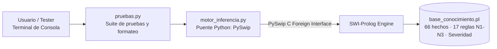
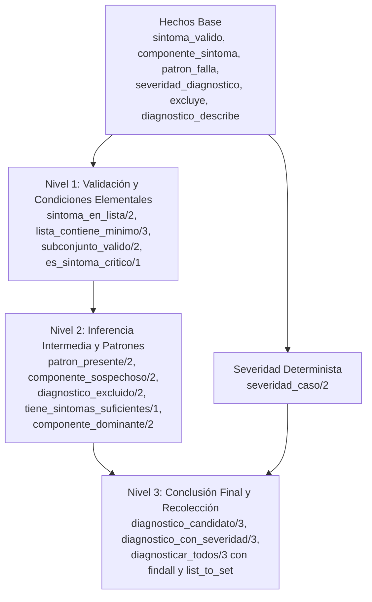
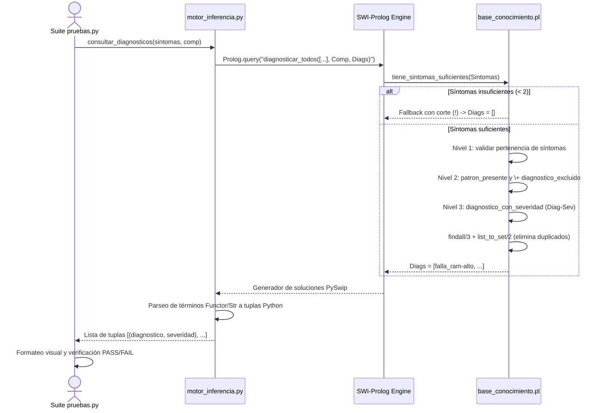

# Arquitectura — Diagramas y Estructura del Sistema

> Complementa la documentación técnica de DiagnostiPC y describe la arquitectura real implementada.

---

## 1. Capas y Responsabilidades



- **Lógica de Inferencia (Prolog):** El 100% de la deducción, descarte, agregación sin duplicados y severidad reside en `base_conocimiento.pl`.
- **Puente y Presentación (Python):** `motor_inferencia.py` encapsula la comunicación con SWI-Prolog, convierte términos y tipos, y entrega resultados estructurados a `pruebas.py`.

---

## 2. Dependencias entre Niveles de Reglas



> **Garantía sin ciclos:** El flujo de dependencia es estrictamente descendente ($H \rightarrow N1 \rightarrow N2 \rightarrow N3$). No existe recursión izquierda ni referencias circulares.

---

## 3. Flujo de una Consulta de Diagnóstico



---

## 4. Mecanismo de Exclusión y Casos Borde

```mermaid
flowchart TD
  In[Lista de Síntomas Observados] --> Suf{¿Tiene al menos 2 síntomas válidos?}
  Suf -- No --> FB[Fallback con corte ! y \+<br/>Retorna lista vacía [] sin error]
  Suf -- Sí --> Pat{¿Coincide con patron_falla/2?}
  Pat -- No --> Disc[No concluyente / Descartado]
  Pat -- Sí --> Exc{¿Está excluido por otro diagnóstico?<br/>\+ diagnostico_excluido/2}
  Exc -- Sí --> Disc
  Exc -- No --> Cand[Diagnóstico Candidato Válido]
  Cand --> Sev[Asignar Severidad Determinista<br/>severidad_diagnostico/2]
  Sev --> Coll[Recolección findall/3 + list_to_set/2]
  Coll --> Out[Lista Final de Diagnósticos Ordenada y Única]
```
