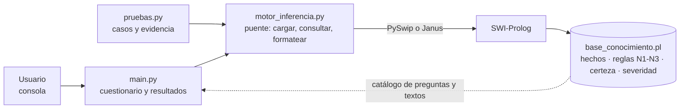
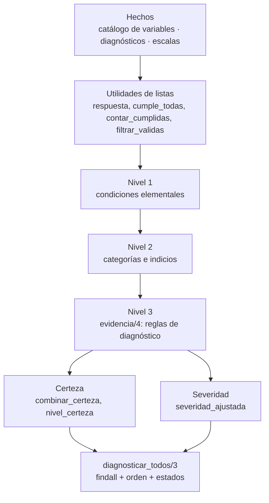
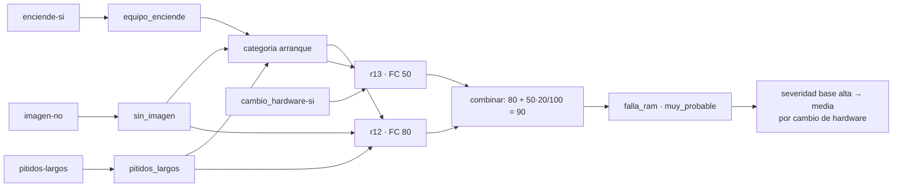
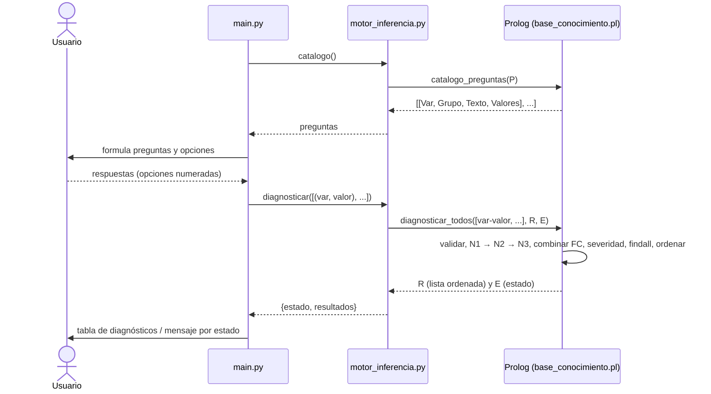
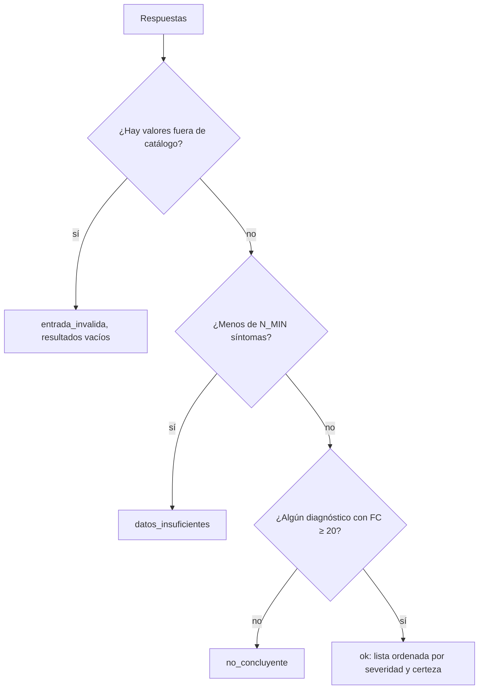

# Arquitectura — diagramas

> Complementa `docs/ai/02-arquitectura.md` (fuente de verdad). Si hay diferencias, manda `02`.

## Capas y responsabilidades

Todo lo que decide está a la derecha del puente; a la izquierda solo se captura, se muestra y se prueba.

## Estructura de `base_conocimiento.pl` y dependencias entre niveles

La flecha es «es usado por». Ninguna dependencia sube de nivel: no hay ciclos por construcción (ADR-004).

## Ejemplo de encadenamiento (caso del Entregable 1)

## Flujo de una consulta

## Decisión de estado (con cortes)

Cada rama es una cláusula de `estado_consulta/3` con corte; la última es el valor por defecto.
