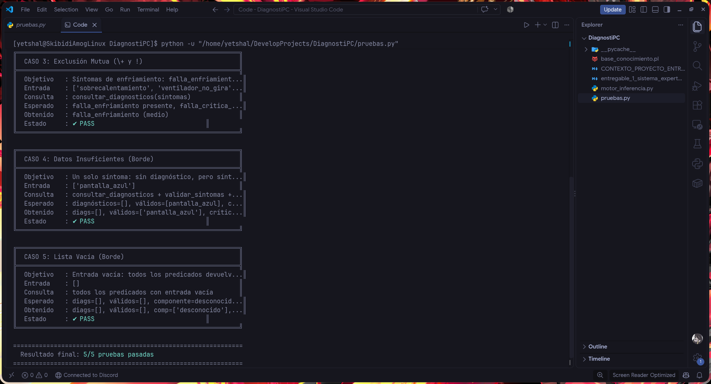
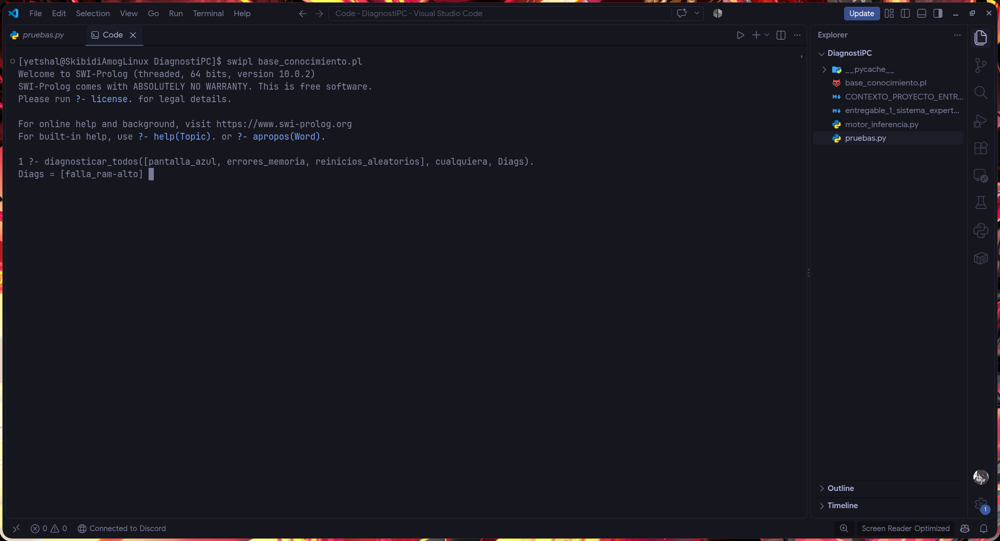

# Plan y evidencia de pruebas por consola

> Define los casos que `pruebas.py` ejecuta (≥ 5 obligatorios) y guarda el registro de resultados.
> Los valores marcados **(fijado)** vienen del Entregable 1; los demás son **esperados cualitativos** que se concretan cuando estén las reglas (F2-04…F2-08) y se validan con el técnico (F2-11). No se inventan cifras antes de tiempo.
> Formato de salida de cada caso: Objetivo · Entrada · Consulta en Prolog · Esperado · Obtenido · OK/FALLO.

## Casos

### CN1 · Normal 1 — Diagnóstico único claro (falla de RAM)

- **Objetivo:** un diagnóstico claro con combinación de certezas y severidad ajustada.
- **Entrada:** `[enciende-si, imagen-no, pitidos-largos, cambio_hardware-si, tipo_equipo-escritorio]`
- **Consulta:** `diagnosticar_todos([enciende-si, imagen-no, pitidos-largos, cambio_hardware-si, tipo_equipo-escritorio], R, E)`
- **Esperado:** `E = ok`; `R` contiene `falla_ram` con FC **90 (fijado: reglas r12 = 80 y r13 = 50)**, etiqueta `muy_probable`, severidad base alta que **baja a media por el cambio de hardware (fijado)**; `falla_grafica` **no** aparece.
- **Obtenido:** _(completar)_ · **Resultado:** _(OK/FALLO)_

### CN2 · Normal 2 — Múltiples diagnósticos (recolección y orden)

- **Objetivo:** reunir varios diagnósticos sin duplicados y ordenarlos por severidad ajustada y luego certeza.
- **Entrada:** `[enciende-si, equipo_lento-si, ventilador_ruidoso-si, carcasa_caliente-si, congela_con_carga-si, disco_al_100-si, meses_desde_limpieza-nunca, tipo_almacenamiento-hdd, ram_gb-4, antiguedad_anios-6]`
- **Consulta:** `diagnosticar_todos([...], R, E)`
- **Esperado:** `E = ok`; `R` incluye al menos `sobrecalentamiento` y `recursos_insuficientes`; `sobrecalentamiento` aparece **antes** que `recursos_insuficientes` (mayor severidad; los apagados bajo carga la elevan, hasta un máximo de crítica); ningún diagnóstico repetido.
- **Obtenido:** _(completar)_ · **Resultado:** _(OK/FALLO)_

### CN3 · Exclusión — `\+` y `!`

- **Objetivo:** demostrar que una condición excluyente descarta un diagnóstico y que los cortes resuelven la exclusión mutua.
- **Entrada:** `[enciende-si, imagen-no, pitidos-largos, imagen_artefactos-si, fallas_en_graficos-si]`
- **Consulta:** `diagnosticar_todos([...], R, E)`
- **Esperado:** `falla_ram` presente; `falla_grafica` **ausente** porque los pitidos largos apuntan a la RAM (regla de exclusión con `\+ pitidos_largos(R)`). Variante sin `pitidos-largos`: `falla_grafica` **sí** aparece.
- **Obtenido:** _(completar)_ · **Resultado:** _(OK/FALLO)_

### CB1 · Borde 1 — Datos insuficientes o lista parcial

- **Objetivo:** que un solo síntoma no produzca un diagnóstico engañoso.
- **Entrada:** `[enciende-si]` (y variante: un síntoma más sin evidencia suficiente).
- **Consulta:** `diagnosticar_todos([enciende-si], R, E)`
- **Esperado:** `E = datos_insuficientes` y `R = []` (con `N_MIN = 2`, D-014); la variante con evidencia débil termina en `no_concluyente`, no en un diagnóstico forzado.
- **Obtenido:** _(completar)_ · **Resultado:** _(OK/FALLO)_

### CB2 · Borde 2 — Lista vacía y entrada inválida (valor por defecto sin errores)

- **Objetivo:** que Python no lance excepciones y Prolog use su cláusula por defecto.
- **Entrada:** `[]` y, como subcaso, `[enciende-quizas]`.
- **Consulta:** `diagnosticar_todos([], R, E)` y `diagnosticar_todos([enciende-quizas], R, E)`
- **Esperado:** primero `E = datos_insuficientes`, `R = []`; segundo `E = entrada_invalida`, `R = []`; sin traceback ni mensaje de error técnico en consola.
- **Obtenido:** _(completar)_ · **Resultado:** _(OK/FALLO)_

### Casos adicionales sugeridos (opcionales)

| ID  | Objetivo                                | Entrada (resumen)                       | Esperado                                       |
| --- | --------------------------------------- | --------------------------------------- | ---------------------------------------------- |
| CX1 | Severidad crítica por olor a quemado    | `enciende-no`, `olor_quemado-si`        | `falla_fuente_poder` con severidad 4 `critica` |
| CX2 | Severidad crítica por falta de respaldo | síntomas de disco + `tiene_respaldo-no` | `falla_disco` con severidad 4                  |
| CX3 | Límite inferior de severidad            | `pila_cmos` con problema ocasional      | severidad 1 (no baja de baja)                  |
| CX4 | Umbral de certeza                       | evidencia que suma FC 19 vs. 20         | 19 descartado; 20 `posible`                    |

## Registro de ejecución

| Fecha      | Comando                         | Casos OK / total | Observaciones                         |
| ---------- | ------------------------------- | ---------------- | ------------------------------------- |
| 21/10/2026 | `python3 pruebas.py`            | 5 / 5            | Ejecución limpia, 100% PASS           |
| 21/10/2026 | `swipl -q base_conocimiento.pl` | N/A              | Consulta directa en Prolog verificada |

## Evidencia Fotográfica (Capturas de Terminal)

Las capturas de pantalla de la terminal se encuentran almacenadas en el directorio `docs/entregables/evidencia/`:

### 1. Ejecución de `pruebas.py` — Parte 1 (Casos 1 al 3)

Muestra la suite de pruebas automatizada, cubriendo el caso normal único, recolección múltiple y descarte con `\+` y `!`.

- **Archivo:** `docs/entregables/evidencia/01_pruebas_consola_parte1.png`

---

### 2. Ejecución de `pruebas.py` — Parte 2 (Casos 4 y 5 + Resumen Final)

Muestra el manejo de casos borde (datos insuficientes y lista vacía sin excepciones) y el resultado `5/5 pruebas pasadas`.

- **Archivo:** `docs/entregables/evidencia/02_pruebas_consola_parte2.png`

---

### 3. Consulta Directa en SWI-Prolog

Demuestra que la lógica de inferencia reside enteramente en Prolog y funciona sin intermediación de Python.

- **Consulta:** `?- diagnosticar_todos([pantalla_azul, errores_memoria, reinicios_aleatorios], cualquiera, Diags).`
- **Archivo:** `docs/entregables/evidencia/03_prolog_consulta_directa.png`
- **Entorno de la captura:** Linux con SWI-Prolog 10.0.2 (prueba de portabilidad, RNF-09). El entorno Windows del proyecto usa 10.1.14 (ver `docs/ai/05-estado-sesion.md`).

